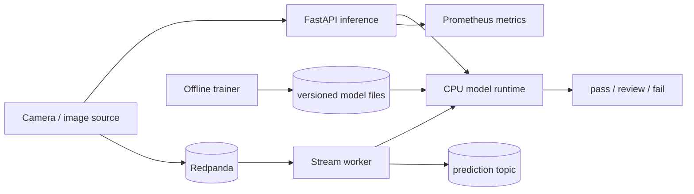

# EdgeSight-QC

EdgeSight-QC is an edge-first reference system for image-based manufacturing quality control. It packages offline training, CPU inference, an HTTP API, and an optional Kafka-compatible stream worker behind one configuration model.

> **Evidence boundary:** the bundled demo is synthetic and illustrative. This repository contains no measured production accuracy, latency, or business-impact claims. Generate reports only from captured artifacts.

## System shape



## Quick start

Prerequisites: Python 3.11, [uv](https://docs.astral.sh/uv/), and optionally Docker.

```bash
cp .env.example .env
uv sync
make check-env
make demo
```

The demo prints `SYNTHETIC DEMO`, generates PNG inputs, runs the shared decision
pipeline, persists DuckDB results, and writes a controlled drift report under
`results/demo/`. Its output must not be presented as a benchmark. Start the
explicit demo API with:

```bash
make api
curl http://127.0.0.1:8080/health/live
```

Set `EDGESIGHT_MODE=real` only from an application that injects actual model
objects. Missing real weights cause startup failure and are never replaced by
synthetic predictions.

## Apple Silicon compatibility

Python 3.11 on M1/M2 is the native development target. Real training selects
MPS only when `torch.backends.mps.is_available()` and falls back to CPU for
unsupported work; set `PYTORCH_ENABLE_MPS_FALLBACK=1` when an operation needs
PyTorch's documented fallback. Defaults use small batches suitable for an 8 GB
Mac. Keep PatchCore distance chunks on CPU if MPS memory is constrained.
Standard Linux Docker containers run CPU inference and cannot access macOS MPS;
no container result should be described as Apple Neural Engine performance.

For local streaming:

```bash
make compose-up
bash scripts/setup_topics.sh
uv sync --extra stream
make stream-worker
make stream-produce FRAME_DIR=results/demo/images
```

The Redpanda console is at <http://localhost:8081>. Shut it down with `make compose-down`.

## Dependency profiles

- Base: API, image preprocessing, CPU ONNX inference, configuration, telemetry.
- `ml`: training/evaluation, PyTorch, Ultralytics, ONNX export.
- `stream`: Kafka/Redpanda consumer and retries.
- `cloud`: Google Cloud Storage and logging adapters.
- `dev`: tests, linting, typing, audit.

Install a profile with `uv sync --extra ml`; install all with `make install-all`. Commit the generated `uv.lock` and use `uv sync --frozen` in CI and releases.

## Expected package contract

Operational scripts intentionally call these stable interfaces:

```text
python scripts/run_demo.py --config PATH --output-dir DIR
python -m edgesight.cli train --config PATH --family FAMILY
python -m edgesight.cli stream --config PATH
edgesight.api.main:app (Uvicorn application)
GET /health/live
GET /health/ready
POST /v1/infer
```

These are implemented entry points. Real mode uses the same strict registry,
decode-once preprocessing, canonical router, and category models in FastAPI and
the stream worker. Missing/corrupt artifacts stop readiness; real mode never
falls back to synthetic predictions.

## Data and model setup

No dataset or pretrained weights are redistributed. MVTec AD access and use are governed by its publisher's terms; obtain it yourself and verify that your intended use is permitted. Set `dataset.license_acknowledged: true` only after review. Keep raw data outside source control.

Ultralytics packages and models may involve AGPL-3.0 obligations or a commercial/enterprise license. Get legal review before network deployment or distribution. Independently review every pretrained checkpoint's source, terms, provenance, and permitted use. The default training config disables pretrained weights.

```text
data/mvtec/              # locally obtained dataset
data/manifest.jsonl      # immutable sample manifest
models/runs/             # training outputs
models/current/          # promoted ONNX + metadata
results/                 # reports and evidence
```

Read [data card](docs/data-card.md), [model card](docs/model-card.md), and [experiments](docs/experiments.md) before training.

After acquiring MVTec AD:

```bash
make data-prepare DATA_ROOT=/absolute/path/to/mvtec
# Review licenses, then set dataset.license_acknowledged=true.
# Provide the local YOLO and ResNet weight paths documented in configs/.
make train
```

Preparation writes leakage-checked `data/splits/splits.json`,
`data/processed/yolo/data.yaml`, empty negative labels, per-category
`normal_train`/`normal_validation` trees, hashes, statistics, and bbox previews.
Held-out `squeeze`, `print`, and `rough` samples are never materialized into
training or calibration directories.

To start real inference after training:

```bash
EDGESIGHT_MODE=real EDGESIGHT_CATEGORY=capsule make api
```

Evaluation can execute the configured real models over the frozen manifest:

```bash
make eval APP_CONFIG=configs/app.yaml
```

## Common operations

Run `make help` for executable targets. Important commands:

- `make check`: lint, strict typing, and tests.
- `make train`: train detector and category PatchCore artifacts with explicit license/weight gates.
- `make eval`: execute real models and write validation-calibrated open-set JSON, Markdown, plots, sample counts, and confidence intervals.
- `make export MODEL_FACTORY=module:function`: export and validate native/ONNX outputs.
- `make quantize MODEL_FACTORY=module:function`: run supported quantization or record `NOT_SUPPORTED`.
- `make bench ARTIFACT=path`: record actual warm-up/timing/throughput/size results.
- `make drift-demo`: run persisted clean, brightness, blur, noise, and compression windows.
- `make optimize-cost PREDICTIONS=path`: run the constrained joint-threshold cost sweep.
- `make report`: transcribe existing JSON artifacts; it does not estimate missing metrics.
- `make docker-build`: build the non-root CPU image.
- `make package`: create and CRC-validate `../H-site.zip`, excluding environments, data, weights, generated results, secrets, caches, and VCS state.
- `scripts/capture_screenshots.sh URL OUTPUT`: capture a reachable live page; never creates placeholders.
- `scripts/deploy_cloud_run.sh`: authenticated Google Cloud Run deployment.

## Security and privacy

Images can contain sensitive operational information. By default telemetry excludes image content. Use object references for streams, authenticate production endpoints, restrict IAM, encrypt storage and transport, rotate secrets, and define deletion periods. Do not put credentials in YAML or `.env` in source control.

## Documentation

- [Architecture](docs/architecture.md)
- [API contract](docs/api.md)
- [Streaming](docs/streaming.md)
- [Deployment](docs/deployment.md)
- [Experiment protocol](docs/experiments.md)
- [Troubleshooting](docs/troubleshooting.md)
- [Decision log](docs/decisions.md)
- [Resume bullets](docs/resume-bullets.md)
- [Interview guide](docs/interview-guide.md)

## License

Original project code is MIT-licensed. Third-party datasets, packages,
pretrained weights, and generated artifacts retain their own terms; dependency
inclusion is not permission for a specific use.
