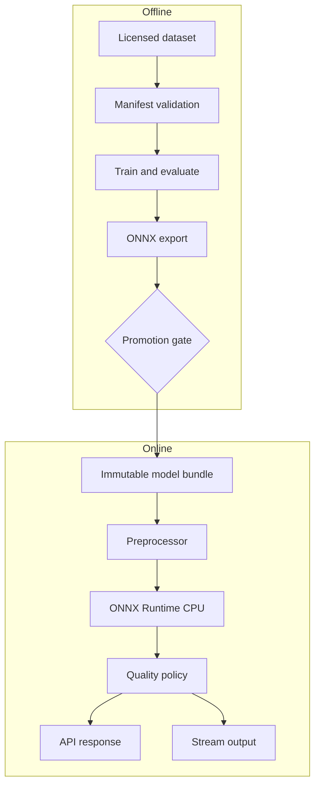

# Architecture

## Goals and boundaries

EdgeSight-QC separates offline, resource-heavy training from deterministic CPU serving. The core boundary is a versioned model bundle: model bytes, preprocessing contract, class map, thresholds, provenance, and checksums. Raw images are never required in logs.

## Components

1. Configuration loader resolves YAML and environment overrides, then validates types.
2. Preprocessor enforces MIME type, size, color space, resize/padding, and normalization.
3. Runtime loads one immutable bundle at startup, warms it, and exposes readiness only after validation.
4. Quality policy maps scores to pass/review/fail; thresholds are model metadata, not hidden constants.
5. API handles bounded uploads and emits stable schemas.
6. Stream worker consumes URI-based events, commits only after output publication, and sends terminal failures to a dead-letter topic.
7. Training writes run-scoped artifacts; promotion is a separate auditable action.

## Failure behavior

Startup fails when config or model metadata is invalid. Readiness fails when the model cannot infer. Invalid requests return 4xx; internal inference errors return a correlation ID and 5xx without image content. Stream retries are bounded, outputs are keyed by event ID, and poisoned records reach the DLQ.

## Scaling

The CPU image uses one application worker by default to avoid duplicate model memory. Scale containers horizontally and tune concurrency from measured resident memory and p95 latency. Kafka partition count caps active stream-worker parallelism.

## Trust boundaries

Client input, object URIs, model bundles, and stream events are untrusted. Validate schemas and checksums, permit-list URI schemes/buckets, cap decompressed pixels, and use least-privilege service identities.
