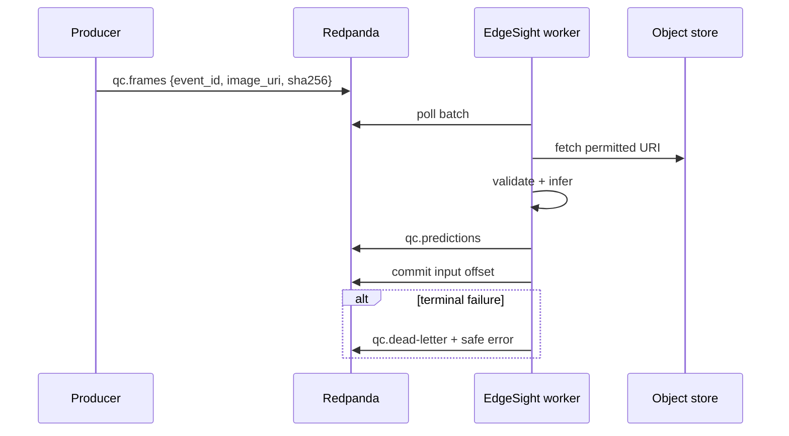

# Streaming

## Event flow



Use object references instead of embedding large images. An input event should include `schema_version`, `event_id`, `captured_at`, `image_uri`, optional `sha256`, and non-sensitive context. Output includes the IDs, model version, decision, scores, processing timestamps, and trace ID.

## Delivery semantics

Kafka processing is at-least-once. Disable auto-commit; publish output before committing input. Key output by `event_id` and make downstream writes idempotent. This is not atomic exactly-once behavior unless transactional production and offset commits are implemented and tested.

Retries are bounded. Retry transient storage/runtime failures; send invalid schemas, unsupported media, checksum mismatches, and exhausted records to the DLQ. Never include image bytes or credentials in DLQ messages.

## Local use

```bash
make compose-up
bash scripts/setup_topics.sh
uv sync --extra stream
make stream
```

The compose stack is for development: one broker, plaintext, one replica. Production requires authentication/TLS, replicated brokers, quotas, retention policy, monitoring, and capacity testing.

## Backpressure

Partition count controls worker parallelism. Bound poll batches, in-flight downloads, inference batches, and output queues. Monitor consumer lag, processing latency, rebalances, error rate, and DLQ volume.
